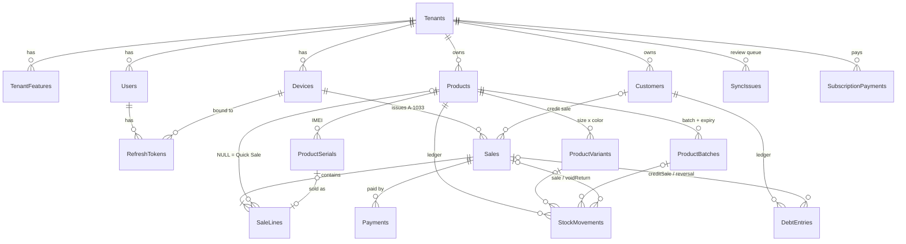

# ZayPOS Backend — Design v1

Phase 2 design: SQL Server schema, offline sync protocol, auth and API for the
ZayPOS mobile app. The Flutter domain models in `mobile/lib/features/**/domain`
are the source of truth; this backend stores and syncs them.

- `schema.sql` — full SQL Server DDL (tables, constraints, indexes)
- This file — architecture, sync rules, API, and the Claude Code prompt

---

## 1. Principles

1. **The phone is the system of record while offline.** It creates ids (UUID v7),
   receipt numbers (`A-1033`) and timestamps. The server never invents ids for synced rows.
2. **Real-world events are never rejected.** A sale, a payment or a debt payment
   already happened in the shop. If it breaks a rule (IMEI already sold, stock
   below zero, credit limit exceeded) the server **accepts it and records a
   `SyncIssue`** for the owner to review.
3. **Ledgers, not balances.** Stock = `SUM(StockMovements.QtyMilli)`.
   Debt = `SUM(effect of DebtEntries)`. No stored balance can drift.
4. **Append-only where money moves.** Sales, lines, payments, stock movements and
   debt entries are inserted once. Corrections are new rows (void reversal,
   adjustment). Only `Sales.VoidedAt` and soft-delete flags change.
5. **One unit of work on the phone = one unit on the server.** The Flutter
   `UnitOfWork` (checkout, void, pay debt, add product) is pushed as one unit and
   applied in one SQL transaction, exactly once.
6. **Tenant isolation everywhere.** `TenantId` comes from the JWT, never from the
   request body. EF Core global query filter on every tenant entity.

Types: money `bigint` kyats · quantity `bigint` milli-units · time `datetime2(3)` UTC ·
text `nvarchar`.

---

## 2. Data model (ERD)



### Dart model → table

| Dart (mobile/lib) | Table | Notes |
|---|---|---|
| `ShopSession`, template id | `Tenants` | `TemplateId` = `ShopTemplate.id` |
| `TenantFeatures` | `TenantFeatures` | key/value rows; key = Dart field name |
| — | `Users` | owner only in v1; PIN hashed |
| `Device` | `Devices` | `Code` + `LastSeq` give receipt numbers |
| `Product` | `Products` | stock NOT stored (ledger) |
| `ProductVariant` | `ProductVariants` | |
| `ProductBatch` | `ProductBatches` | `qtyMilli` becomes derived (sum of movements by `BatchId`) |
| `ProductSerial` | `ProductSerials` | |
| `StockMovement` | `StockMovements` | append-only |
| `Customer` | `Customers` | balance NOT stored (ledger) |
| `DebtEntry` | `DebtEntries` | append-only, same sign rules as `DebtEntry.effect` |
| `Sale` | `Sales` | `syncedAt` ⇐ `ReceivedAt`; `Total` recomputed by server |
| `SaleLine` | `SaleLines` | `ProductId` NULL = Quick Sale; `LineTotal` recomputed |
| `Payment` | `Payments` | never `debt` |
| — | `ProcessedUnits`, `SyncIssues` | sync bookkeeping |
| — | `PresetProducts` | global starter catalog per template |
| — | `SubscriptionPayments` | manual KBZPay/WavePay + screenshot on R2 |

**Required Flutter follow-ups** (small, do in Phase 3): `ProductBatch.qtyMilli`
→ derived from movements; `StockMovement` and `DebtEntry` get `deviceId`;
add a `SyncIssue` model for the review screen.

---

## 3. Sync protocol

Two endpoints. The phone pushes its outbox, then pulls everything newer than its cursor.

### 3.1 Push — `POST /api/v1/sync/push`

```json
{
  "deviceId": "0193…",
  "units": [
    {
      "unitId": "0193…",              // = client UnitOfWork id, idempotency key
      "kind": "checkout",             // checkout|voidSale|payDebt|upsertProduct|upsertCustomer|setFeatures|stockAdjust|restock
      "clientTime": "2026-11-11T09:12:03.120Z",
      "rows": {
        "sales":          [ { …Sale columns… } ],
        "saleLines":      [ … ],
        "payments":       [ … ],
        "stockMovements": [ … ],
        "debtEntries":    [ … ],
        "productSerials": [ { "id": "…", "status": "sold", "saleLineId": "…", "updatedAt": "…" } ],
        "devices":        [ { "id": "…", "lastSeq": 1033 } ]
      }
    }
  ]
}
```

Server, **per unit, in order, each in its own transaction**:

1. If `(TenantId, UnitId)` is in `ProcessedUnits` → return its previous outcome (idempotent retry).
2. Validate shape: every row's `TenantId` must equal the token's tenant; ids are
   valid UUIDs; amounts/quantities are integers. Shape errors → `rejected` (only case that rejects).
3. Apply rows by table rule (3.3). Recompute `Sales.Total` and `SaleLines.LineTotal`
   from price × qty; if the client value differs, store the server value and add a `SyncIssue`.
4. Run business checks → add `SyncIssue` rows, never block (3.4).
5. Insert into `ProcessedUnits`, commit.

Response:

```json
{ "results": [ { "unitId": "…", "outcome": "applied" | "skipped" | "rejected", "reason": null, "issues": ["serialDoubleSold"] } ],
  "serverTime": "2026-11-11T09:12:04.002Z" }
```

The phone removes `applied`/`skipped` units from its outbox. For a `skipped`
unit (e.g. the same sale was already voided from another phone) the phone also
**deletes that unit's local rows**, so its reversal movements/entries do not
count twice; the next pull brings the server's version. A `rejected` unit
stays visible in a "sync problems" list (should only happen from bugs).
Batch size: max 50 units per request; the phone loops until the outbox is empty.

### 3.2 Pull — `GET /api/v1/sync/pull?cursor=<hex>&limit=500`

The cursor is the SQL Server `rowversion` (database-wide, always increasing).

```sql
DECLARE @upper binary(8) = MIN_ACTIVE_ROWVERSION();
SELECT … FROM <table>
WHERE TenantId = @t AND Version > @cursor AND Version < @upper
ORDER BY Version
```

`MIN_ACTIVE_ROWVERSION()` is required: a transaction that is still open may hold
a *lower* rowversion than rows already committed. Without the upper bound a pull
can move the cursor past it and that row is never downloaded.

Run for every synced table, merge, take the first `limit` rows by `Version`.

```json
{ "changes": { "products": [ … ], "stockMovements": [ … ], "sales": [ … ], … },
  "cursor": "00000000000A3F21", "hasMore": false }
```

Rows include soft-deleted ones (`deletedAt` set) so phones can remove them.
First install: cursor = `0` (full download). The phone stores the cursor only
after it has saved the whole page in one Drift transaction.

### 3.3 Conflict rules by table

| Table | Rule |
|---|---|
| `Sales`, `SaleLines`, `Payments`, `StockMovements`, `DebtEntries` | **Insert-only.** Existing id → ignore (already applied). No conflicts possible. |
| `Sales.VoidedAt` | State transition. `voidSale` unit applies only if the server state differs from the target; otherwise the whole unit is `skipped` (its reversal movements/entries are not inserted twice). |
| `Products`, `ProductVariants`, `ProductBatches`, `Customers`, `TenantFeatures`, `Tenants` | **Last writer wins** by `UpdatedAt`. Incoming `UpdatedAt` is clamped to `serverTime + 5 min` (clock skew → `SyncIssue clockSkew`). |
| `ProductSerials.Status` | Accept; if it was already `sold` by another sale → keep both sales, add `SyncIssue serialDoubleSold`. |
| `Devices.LastSeq` | `MAX(server, incoming)` — only moves forward. |
| Soft delete | `DeletedAt` set wins over later edits of other fields (a deleted item stays deleted unless explicitly restored). |

### 3.4 Business checks → `SyncIssues` (never reject)

| Kind | When |
|---|---|
| `serialDoubleSold` | Two sales claim the same `ProductSerial`. |
| `negativeStock` | A product's ledger sum drops below 0 after the unit. |
| `duplicateBarcode` | Two live products in a tenant share a barcode. |
| `creditLimitExceeded` | Customer balance > `CreditLimit` after a credit sale. |
| `clockSkew` | Device time more than 5 minutes ahead of the server. |
| `totalMismatch` | Client total ≠ server recomputed total. |

Issues sync down like any table; the app shows them in Settings → "စစ်ရန်".

### 3.5 Receipt numbers

`Device.Code` is assigned by the server when a device registers (next free code
per tenant: A, B, … Z, AA …). The phone increments `LastSeq` locally and formats
`<Code>-<seq padded to 4>`. `UX_Sales_No (TenantId, No)` guarantees uniqueness;
a collision can only come from a reinstall reusing a code, so a reinstalled app
always registers as a **new** device.

---

## 4. Auth

| Step | Endpoint | Result |
|---|---|---|
| Ask OTP | `POST /api/v1/auth/otp` `{ phone, purpose }` | SMS 6-digit code (5 min, 5 attempts, rate-limit 3/hour/phone) |
| Register | `POST /api/v1/auth/register` `{ phone, otp, shopName, templateId, township, pin, device: { id, name } }` | creates Tenant, owner User, TenantFeatures from template, Device `A`; returns tokens |
| Login on a new phone | `POST /api/v1/auth/login` `{ phone, pin, device: { id, name } }` | registers next Device code; returns tokens |
| Refresh | `POST /api/v1/auth/refresh` `{ refreshToken }` | rotates refresh token (old one revoked) |
| Reset PIN | `POST /api/v1/auth/pin/reset` `{ phone, otp, newPin }` | |

- Access token: JWT, 15 min, claims `sub` (user), `tid` (tenant), `did` (device), `role`.
- Refresh token: random 32 bytes, stored as SHA-256, 90 days, bound to the device.
- PIN: `PasswordHasher<User>`; lock 15 min after 5 wrong PINs.
- Offline: the phone keeps the last session and checks the PIN against a local
  hash (flutter_secure_storage). Sync waits until a token can be refreshed.
- SMS provider is behind `ISmsSender`; v1 dev implementation logs the code.

---

## 5. API surface (v1)

All under `/api/v1`, JSON, ProblemDetails for errors, Swagger UI at `/swagger` (dev only).

| Area | Endpoints |
|---|---|
| Auth | see §4 |
| Sync | `POST /sync/push`, `GET /sync/pull`, `GET /sync/limits` (anonymous: every text/number limit the push validator enforces, from `SyncLimits`) |
| Me | `GET /me` (user, tenant, features, plan, devices) |
| Catalog presets | `GET /catalog/presets?template=grocery` (cached, ETag) |
| Devices | `GET /devices`, `DELETE /devices/{id}` (owner revokes a lost phone) |
| Subscription | `POST /subscription/screenshot-url` (R2 presigned PUT), `POST /subscription/payments`, `GET /subscription` |
| Reports (for Blazor) | `GET /reports/summary?from&to`, `GET /reports/top-products?from&to`, `GET /reports/debt` |
| Admin (internal) | `GET /admin/subscription-payments?status=pending`, `POST /admin/subscription-payments/{id}/approve` — role `admin`, separate policy |

Config: `Storage:R2:{AccountId,AccessKeyId,SecretAccessKey,Bucket}` (user-secrets / env; without it the
screenshot endpoints answer 503 `storage_not_configured`), `Subscription:Prices[]` (`{months, amount}`) and
`Subscription:PayTo` (`kbz`/`wave` → account shown to the owner). `DELETE /devices/{id}`, the screenshot URL and
`POST /subscription/payments` need role `owner`; every endpoint above refuses a revoked device's token.

The mobile app only needs **auth, sync, me, presets, subscription**. CRUD for
products/customers/sales goes through sync, not REST.

---

## 6. Solution structure

```
backend/
  ZayPOS.slnx
  src/
    ZayPOS.Domain/          entities, enums, ledger math (no EF, no ASP.NET)
    ZayPOS.Application/     sync engine (unit appliers, rules, issue detection), auth services, interfaces
    ZayPOS.Infrastructure/  EF Core DbContext, configurations, migrations, SmsSender, R2 storage, JWT
    ZayPOS.Api/             minimal APIs or controllers, auth, Swagger, ProblemDetails, rate limiting
    ZayPOS.Web/             Blazor admin (Phase 4 — leave empty for now)
  tests/
    ZayPOS.Domain.Tests/
    ZayPOS.Api.Tests/       WebApplicationFactory + real SQL Server (Testcontainers)
```

### Local dev on macOS

SQL Server does not run natively on macOS — use Docker Desktop
(Settings → General → "Use Rosetta for x86/amd64 emulation on Apple Silicon"):

```bash
docker run -d --name zaypos-sql -e ACCEPT_EULA=Y -e MSSQL_SA_PASSWORD='Zaypos!Dev2026' \
  -p 1433:1433 mcr.microsoft.com/mssql/server:2022-latest
```

SSMS is Windows-only; on Mac use VS Code with the **SQL Server (mssql)** extension.

---

## 7. Claude Code prompt (Phase 2)

Run Claude Code from the repo root (`ZayPOS/`) and paste:

````text
Build the ZayPOS backend (Phase 2) in ./backend, following docs/backend/README.md and docs/backend/schema.sql exactly.
The Flutter models in mobile/lib/features/**/domain are the source of truth for field names and meaning.

STACK: .NET 10, ASP.NET Core Web API, EF Core 10 (SqlServer provider), SQL Server 2022 in Docker,
Swashbuckle for Swagger UI, xUnit + FluentAssertions + Testcontainers.MsSql. No other frameworks without asking.

STEP 1 — Solution + Domain + EF Core
- Create the solution layout from README §6.
- Entities + IEntityTypeConfiguration classes that produce EXACTLY schema.sql
  (types, lengths, check constraints, filtered indexes, nonclustered PK + clustered (TenantId, CreatedAt), rowversion Version).
- Initial migration. Then generate a script with `dotnet ef migrations script` and diff it against schema.sql; fix differences.
- Global query filter on TenantId (from ICurrentTenant) for every tenant entity.
STOP and show me the migration script diff summary.

STEP 2 — Auth (README §4)
- OTP (ISmsSender with a dev logger implementation), register (creates tenant + owner + features from template + device A),
  login (new device gets next code), refresh with rotation, PIN reset, lockout, rate limiting on /auth/*.
- Template → features mapping must match mobile/lib/core/features/shop_template.dart.

STEP 3 — Sync (README §3) — the most important part
- POST /sync/push: per unit, one transaction, idempotent via ProcessedUnits, table rules from §3.3,
  server recomputes totals, business checks write SyncIssues (§3.4), never reject real-world events.
- GET /sync/pull: rowversion cursor across all synced tables, upper bound MIN_ACTIVE_ROWVERSION(), paging, includes soft-deleted rows.
- Every row's TenantId must equal the token's tid.

STEP 4 — Me, presets (seed ~20 grocery presets as sample data), devices, subscription (R2 presigned URL behind IFileStorage).

TESTS (integration, real SQL Server via Testcontainers):
- push same unit twice → applied once; checkout unit inserts sale+lines+payment+movements(+debt) atomically
- void then void again → second skipped, stock and debt restored once
- two devices sell same IMEI → both sales stored + serialDoubleSold issue
- stock below zero → negativeStock issue, sale kept
- pull returns only rows after cursor, paging works, other tenant's rows never appear
- LWW on Products by UpdatedAt; future UpdatedAt clamped + clockSkew issue
- auth: wrong PIN x5 locks; refresh rotation revokes old token

Work step by step and wait for my OK after STEP 1. Run `dotnet build` and `dotnet test` after every step.
````
